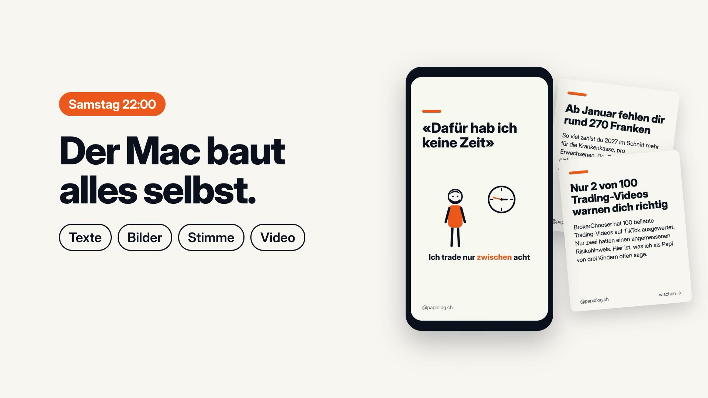

# Content-Fliessband

Automatisches Content-Fliessband für Instagram und Facebook: plant, baut und postet jede Woche 2 Reels und 2 Karussells. Du gibst nur in Telegram frei.

[](docs/media/brag.mp4)

*Klick aufs Bild für das Video (25 s). Gezeigt sind echte Beiträge von @papiblog.ch, für die das Fliessband ursprünglich gebaut wurde.*

## Was es macht

Jede Woche läuft derselbe Zyklus:

1. **Fr 20:00, Lern-Schleife:** wertet die Zahlen der letzten Beiträge aus und schreibt `learnings.md` fort.
2. **Fr 22:00, Planung:** Der Wochen-Planer legt 4 Beiträge fest (2 Reels, 2 Karussells, mit dem Schalter `plaetze` 6) und stellt offene Fragen. Ist der Trend-Scout eingeschaltet, sucht er davor im Web nach aktuellen Themen.
3. **Sa 22:00, Bau:** Texte, Bilder, Stimme, Video, Aussprache-Check und Faktencheck entstehen automatisch.
4. **Freigabe in Telegram:** Jeder Beitrag kommt mit ✅ Freigeben, ✏️ Ändern oder ❌ Verwerfen.
5. **Standard Di, Mi, Do, Sa 19:00** (einstellbar mit `FLIESSBAND_POSTTAGE` und `FLIESSBAND_POSTZEIT`): Der Server postet die freigegebenen Beiträge auf Instagram und, wenn eingeschaltet, auf Facebook.
6. **START-Kommentare:** Der Server liest die Kommentare und meldet jedes «START» in Telegram.

Ohne Freigabe geht nichts online.

## Die elf Stufen

1. **Karussell-Bauer:** baut Karussells aus Agentur-Beiträgen (`lib/bauer.py`).
2. **Reel-Bauer:** baut Erklär-Reels mit ElevenLabs-Stimme und HyperFrames (`lib/reel_bauer.py`).
3. **Wochen-Planer:** plant die Woche und stellt Fragen an dich (`lib/planer.py`, `lib/wochenplan.py`).
4. **Freigabe in Telegram:** Du entscheidest per Knopf (`lib/freigabe.py`, `lib/entscheide.py`).
5. **Poster:** postet die freigegebenen Beiträge zum Termin auf Instagram und Facebook (`server/briefkasten/poster.py`).
6. **Lern-Schleife:** wertet die Zahlen aus und passt die Regeln an (`lib/lernen.py`).
7. **Kurze und mittlere Reels:** die Länge wird geprüft. Reels über 60 Sekunden bekommen einen Hinweis.
8. **Aussprache-Check:** findet Wörter, die die Stimme falsch spricht, und schlägt einen Ersatz vor (`lib/aussprache.py`, `docs/agents/aussprache-agent.md`).
9. **Kontakt per START:** Der Server meldet START-Kommentare in Telegram (`server/briefkasten/kommentare.py`).
10. **Faktencheck:** prüft Zahlen und Behauptungen jedes Beitrags vor dem Bauen gegen Quellen, Schalter `fakten` (`lib/fakten.py`, `docs/agents/fakten-agent.md`).
11. **Trend-Scout:** sucht am Freitag im Web nach aktuellen Themen für den Planer, Schalter `trends`, Standard aus (`lib/trendscout.py`, `docs/agents/trend-scout.md`).

## Voraussetzungen

- **macOS** mit launchd und Schlüsselbund. Die Jobs laufen nur, wenn der Mac wach ist.
- **Python 3.12**
- **Node 22**
- **ffmpeg**
- **Claude Code** (Befehl `claude` im PATH)
- **ElevenLabs-Konto** mit API-Schlüssel und einer eigenen Stimme (Voice-ID)
- **Telegram-Bot** (Token von @BotFather)
- **Eigene Meta-App** mit Instagram API und Instagram-Login. Die App muss im Modus **«Veröffentlicht»** laufen. Im Entwicklungsmodus liefert Instagram keine Kommentare von fremden Konten. Die START-Erkennung funktioniert dann nicht. Die App braucht die Berechtigung `instagram_business_manage_comments`. Für Facebook zusätzlich eine Facebook-Seite.
- **Kleiner Linux-Server** (z.B. ein VPS), der über Tailscale erreichbar ist. Python 3.10 oder neuer und SQLite 3.24 oder neuer.
- **WordPress-Seite mit Mediathek** oder ein anderer Dienst, der öffentliche Medien-URLs liefert. Instagram und Facebook holen Bilder und Videos von dort.
- **Die Social-Media-Agentur** (siehe unten).

## Wichtig: Abhängigkeit von der Social-Media-Agentur

Dieses Projekt baut auf der Social-Media-Agentur von **Sebastian Kauffmann** auf: <https://github.com/sebaskauf/social-agentur> (Skill `/agentur`). Die Agentur ist seine Arbeit. Sie muss zuerst installiert sein, danach kommt dieses Repo. Dieses Repo ist eine Erweiterung auf der Agentur und ersetzt sie nicht.

Die Agentur liefert die Texte und die Daten: `profil.md`, `stimme.md` und `learnings.md` im Agentur-Ordner. Ohne sie laufen Planer und Texter nicht. `geschichten.md` legt das Fliessband selbst an. Das Agentur-Werkzeug liegt nicht in diesem Repo.

## Einrichtung

**Ausführliche Anleitung:** [docs/anleitung/00-ueberblick.md](docs/anleitung/00-ueberblick.md), neun Schritte mit je einem Kapitel. Nach jedem Schritt prüft der Assistent `./fliessband einrichten` (mit `--online` auch Server und Instagram), was noch offen ist. Er liest nur und zeigt nie einen Schlüssel. Die Anleitung ist ein Entwurf und noch nicht von null auf frischen Konten getestet. Unten steht die Kurzfassung.

1. **Agentur installieren.** Folge der Anleitung im Agentur-Repo. Der Skill muss unter `~/.claude/skills/agentur` liegen, der Agentur-Ordner unter `~/meine-agentur`. Die Agentur legt `meine-agentur/` dort an, wo du Claude Code startest, also `cd ~ && claude` vor `/agentur start`. Liegt er woanders, setze die Pfade in `.env`.

2. **Repo klonen:**

   ```bash
   git clone https://github.com/dinubuser/content-fliessband.git
   cd content-fliessband
   ```

3. **Installieren:**

   ```bash
   ./install.sh
   ```

   Das Skript prüft die Voraussetzungen, legt `.venv` an, installiert die Python- und Node-Pakete, legt `.env` aus `.env.example` an und kopiert die Agenten für Aussprache, Faktencheck und Trend-Scout nach `~/.claude/agents/`. Es fasst den Schlüsselbund nicht an. Mit `--launchd` richtet es zusätzlich die Jobs ein (Schritt 9).

4. **`.env` ausfüllen.** Ersetze alle Platzhalter (`your-…`, `your_…`, `example.com`, `@dein.konto`). Geheimnisse gehören nicht in `.env`.

5. **Geheimnisse in den Schlüsselbund.** Die Namen müssen zu `.env` passen:

   ```bash
   security add-generic-password -s fliessband-telegram -a fliessband -w    # Bot-Token
   security add-generic-password -s elevenlabs-api -a "$USER" -w           # ElevenLabs-Schlüssel
   security add-generic-password -s fliessband-wp -a <WP-Benutzer> -w      # WordPress-Anwendungspasswort
   security add-generic-password -s fliessband-facebook-app -a fliessband -w   # nur mit Facebook
   ```

   Der Befehl fragt den Wert interaktiv ab. Er steht dann nicht in der Shell-Historie.

6. **Telegram-Bot verbinden.** Schicke dem Bot `/start` und führe danach aus:

   ```bash
   ./fliessband bot einrichten
   ```

   Die Chat-ID landet in `daten/bot.json`.

7. **Server einrichten.** Die Skripte in `server/` laufen in dieser Reihenfolge:

   ```bash
   ssh -i ~/.ssh/DEIN_SCHLUESSEL root@SERVER 'bash -s' < server/einrichten.sh   # Benutzer und Ordner
   server/zugang.sh                       # Mac: Zugang zwischen Mac und Server (braucht daten/bot.json)
   server/deploy.sh                       # Code auf den Server, Tests dort, Dienst starten
   server/instagram.sh                    # Instagram-Schlüssel der Agentur auf den Server
   ./fliessband briefkasten umstellen     # ab jetzt fragt der Server Telegram ab
   ```

   Optional legst du auf dem Server `/etc/fliessband/konfig.env` mit `FLIESSBAND_HOST=<Tailscale-IP>` an. Der Dienst hört dann nur im Tailscale-Netz. Ohne diese Datei hört er auf `127.0.0.1`.

   Facebook ist optional. Dafür `server/facebook.sh` ausführen und mit `./fliessband facebook ein` einschalten.

8. **Meta-App prüfen.** Die App läuft im Modus «Veröffentlicht» (siehe Voraussetzungen). Der Instagram-Schlüssel braucht `instagram_business_manage_comments`.

9. **launchd-Jobs einrichten.** Erst wenn `.env` vollständig ist:

   ```bash
   ./install.sh --launchd
   ```

   Das Skript richtet die Jobs für Lern-Schleife, Planung, Bau und Entscheide ein. Den Wecker für Fr und Sa 21:55 setzt du danach selbst (der Befehl steht in der Ausgabe).

10. **Erster Testlauf:**

    ```bash
    .venv/bin/pytest -q -m "not langsam"    # Tests, ohne HyperFrames-Render
    ./fliessband karussell <beitrag.md>     # ein Karussell aus einem Agentur-Beitrag bauen
    ./fliessband woche status               # Stand der Woche
    ```

## Befehle

| Befehl | Was er tut |
|--------|------------|
| `./fliessband karussell <beitrag.md> [--termin YYYY-MM-DDTHH:MM]` | Karussell aus einem Agentur-Beitrag bauen |
| `./fliessband reel <reel.md> [--termin YYYY-MM-DDTHH:MM]` | Erklär-Reel aus einem Agentur-Reel-Skript bauen |
| `./fliessband woche vorbereiten\|bauen\|senden\|anmelden\|status [--woche 2026-KW44]` | Schritte der Woche einzeln ausführen oder den Stand zeigen |
| `./fliessband lernen [--probe]` | Lern-Schleife jetzt ausführen (`--probe` zeigt nur die Zahlen) |
| `./fliessband entscheide` | Entscheide aus Telegram umsetzen (läuft per launchd) |
| `./fliessband einrichten [--online]` | Einrichtung prüfen: neun Schritte, nächster offener Schritt (liest nur) |
| `./fliessband bot einrichten` | Chat-ID speichern, nachdem du dem Bot `/start` geschickt hast |
| `./fliessband briefkasten umstellen` | Einmalig: Telegram-Abfrage an den Server übergeben |
| `./fliessband poster ein\|aus\|status` | Automatisches Posten auf Instagram (Server) |
| `./fliessband facebook ein\|aus\|status` | Zusätzlich auf die Facebook-Seite posten (Server) |
| `./fliessband kommentare ein\|aus\|status` | START-Kommentare in Telegram melden (Server) |

## Anpassen

Die Regeln für Stimme, Marke und Themen sind Beispiele. Sie stehen mit dem Marker `[BEISPIEL ... anpassen]` an diesen Stellen:

- `lib/planer.py`: Regeln für Themen und Stil
- `lib/texter.py`: Regeln für Finanz-Themen und Schreibweise
- `lib/lernen.py`: Vorgaben für den Bericht der Lern-Schleife
- `lib/konkurrenz.py`: Gruppen von Konkurrenz-Accounts
- `docs/agents/aussprache-agent.md`: Helvetismen, Abkürzungen und das Handle
- `docs/agents/trend-scout.md` und `lib/trendscout.py`: Themenfelder und Quellen für die Web-Suche
- `aussprache.txt`: Wörter, die die Stimme anders aussprechen soll (Format: `Wort → Ersatz`)

Ersetze die Beispiele durch deine eigene Stimme, Marke und Regeln. Die Figuren in `vorlagen/reel-a/figuren/` lassen sich ebenfalls durch eigene Grafiken ersetzen.

## Sicherheit

- **Nichts geht ohne Freigabe online.** Der Server postet nur Beiträge, die du in Telegram freigegeben hast.
- **Geheimnisse nur im Schlüsselbund** (Mac) und in `/etc/fliessband/geheim.env` (Server, nur root und Gruppe `fliessband`).
- **`.env` nie committen.** Die Datei steht in `.gitignore`. Vorlage ist `.env.example`.
- **Laufzeitdaten bleiben lokal:** `wochen/`, `daten/`, `logs/` und `zwischenspeicher/` stehen in `.gitignore`.

## Using with Claude Code

Dieses Projekt enthält eine `CLAUDE.md`, die Claude Code den vollen Kontext gibt: Befehle, Architektur, Konfiguration und Regeln.

```bash
claude    # Start Claude Code, reads CLAUDE.md automatically
```

## Lizenz

MIT, siehe [LICENSE](LICENSE).

Die Schrift `vorlagen/karussell-a/fonts/InterVariable.ttf` (Inter, Copyright 2016 The Inter Project Authors) steht unter der SIL Open Font License 1.1. Der Lizenztext liegt in `vorlagen/karussell-a/fonts/OFL.txt`.

Die Social-Media-Agentur von Sebastian Kauffmann ist nicht Teil dieses Repos. Ihre Lizenz gilt dort.

## Mitmachen

Siehe [CONTRIBUTING.md](CONTRIBUTING.md).
